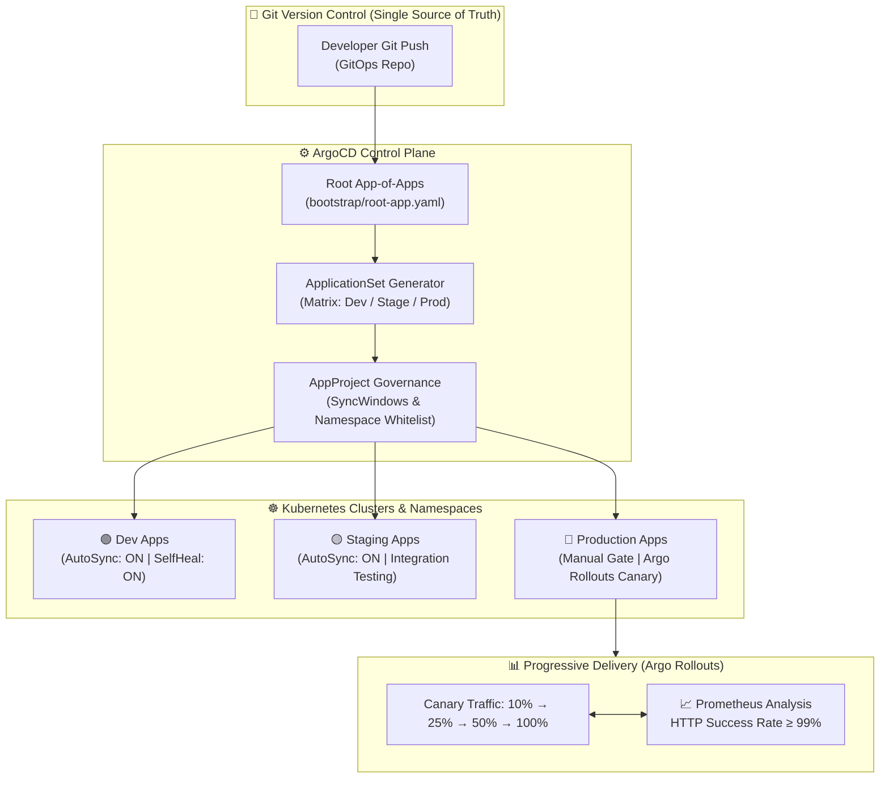

# 🔄 GitOps Delivery Platform with ArgoCD, ApplicationSets & Helm

[](https://github.com/shyam-codeops/gitops-argocd-helm/actions)
[](https://argoproj.github.io/cd/)
[](https://argoproj.github.io/argo-rollouts/)
[](https://helm.sh)
[](https://kubernetes.io)
[](LICENSE)

An enterprise-grade **GitOps continuous delivery control repository** utilizing **ArgoCD**, **ApplicationSets**, **Helm**, and **Argo Rollouts**. Implements the *App-of-Apps* declarative pattern, matrix environment generators (Dev, Stage, Prod), governance policies via `AppProject` sync windows, and automated canary deployments with real-time Prometheus metric validation.

---

## 🏛️ GitOps Continuous Delivery Architecture



---

## 💎 Core Architecture Patterns

| Pattern | Implementation | Production Value |
| :--- | :--- | :--- |
| **App-of-Apps Pattern** | `bootstrap/root-app.yaml` | Bootstraps the entire cluster infrastructure and application stack from a single root declarative manifest. |
| **Matrix ApplicationSet** | `bootstrap/applicationset-environments.yaml` | Dynamically provisions applications across matrix generators (`[dev, stage, prod]` × `[frontend, payment]`) with zero duplicate YAML. |
| **Argo Rollouts Canary** | `progressive-delivery/canary-rollout.yaml` | Eliminates downtime and deployment blast radius by shifting traffic incrementally with automated rollback on Prometheus SLO degradation. |
| **AppProject Guardrails** | `bootstrap/argocd-project.yaml` | Restricts target clusters and namespaces, blocks weekend production deployments via `syncWindows`, and enforces least privilege. |
| **Self-Healing & Drift** | `syncPolicy.automated.selfHeal: true` | Automatically detects out-of-band cluster modifications and reverts drift back to git specification within seconds. |

---

## 📁 Repository Structure

```tree
gitops-argocd-helm/
├── .github/
│   └── workflows/
│       └── ci.yml                 # Automated manifest & syntax tests
├── bootstrap/
│   ├── root-app.yaml              # Root App-of-Apps Application
│   ├── applicationset-environments.yaml # Matrix ApplicationSet generator
│   └── argocd-project.yaml        # AppProject with syncWindows & RBAC
├── charts/
│   └── app-template/              # Reusable parameterized Helm chart
│       ├── Chart.yaml
│       ├── values.yaml
│       └── templates/
│           └── all.yaml           # Deployment, Service, Ingress, HPA
├── apps/
│   ├── ecommerce-frontend/
│   │   ├── dev/values.yaml        # Dev overrides (1 replica, auto-sync)
│   │   └── prod/values.yaml       # Prod overrides (5 replicas, HPA, TLS)
│   └── payment-service/
│       └── prod/values.yaml
├── progressive-delivery/
│   └── canary-rollout.yaml        # Rollout steps & Prometheus AnalysisTemplate
├── tests/
│   ├── __init__.py
│   └── test_gitops_manifests.py   # Automated unit tests
├── .gitignore
├── LICENSE
└── README.md
```

---

## 🚀 Quickstart & Deployment

### 1. Run Automated Test Suite (Zero External Dependencies)
Validate all GitOps specifications:

```bash
git clone https://github.com/shyam-codeops/gitops-argocd-helm.git
cd gitops-argocd-helm

python -m unittest discover -s tests -p "test_*.py" -v
```

### 2. Bootstrap ArgoCD on Kubernetes
Apply the root application into the `argocd` namespace:

```bash
# Apply AppProject governance
kubectl apply -f bootstrap/argocd-project.yaml

# Apply Root App-of-Apps
kubectl apply -f bootstrap/root-app.yaml
```

ArgoCD will detect the ApplicationSet and automatically instantiate all microservices across `dev`, `stage`, and `prod`.

### 3. Progressive Canary Deployment Flow
When updating an image in `progressive-delivery/canary-rollout.yaml`:
1. Argo Rollouts deploys the new revision to **10%** of traffic.
2. An automated `AnalysisRun` monitors Prometheus for 5 minutes:
   $$\text{Success Rate} = \frac{\sum \text{rate}(\text{http\_requests\_total}\{\text{status} \ne 5xx\})}{\sum \text{rate}(\text{http\_requests\_total})} \ge 99\%$$
3. If metric check succeeds, traffic advances to **25%**, then **50%**, and finally **100%**.
4. If metric check fails (e.g., error rate > 1%), Argo Rollouts instantly aborts and reverts traffic to the stable replica set with zero downtime.

---

## 👤 Author

**Shyam Singh**
* GitHub: [@shyam-codeops](https://github.com/shyam-codeops)
* Role: DevOps Engineer

---

## 📄 License
This project is licensed under the MIT License - see the [LICENSE](LICENSE) file for details.
